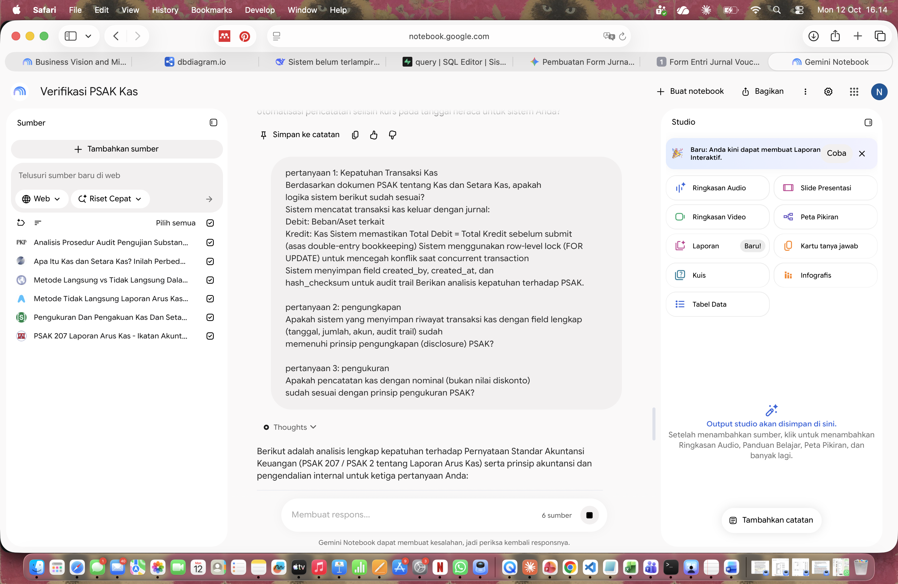
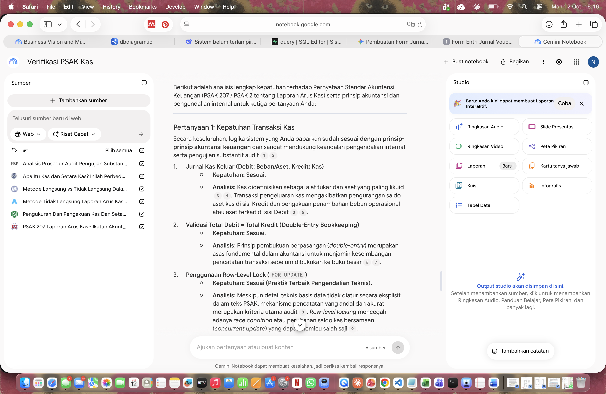
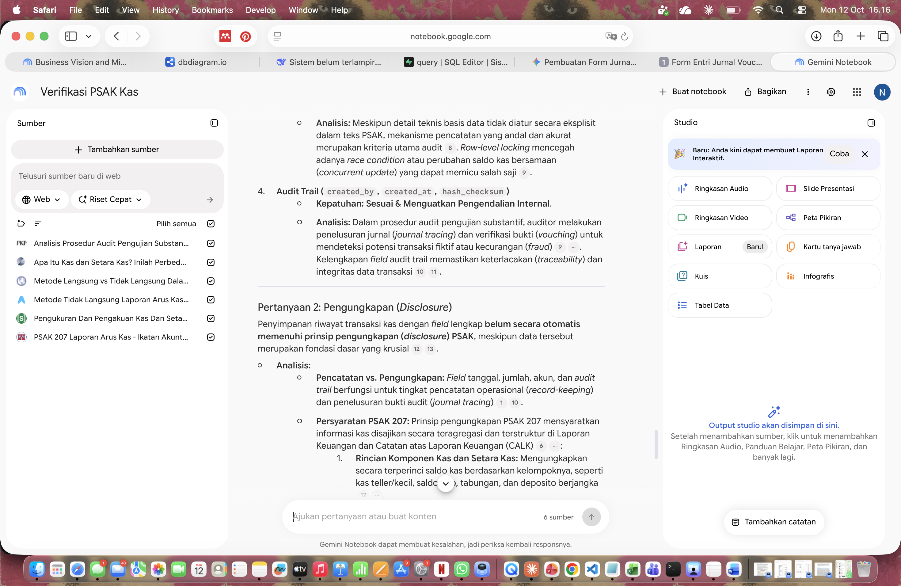

## 3.1a. Orkestrasi Gemini Canvas

# Soal 3: Integrasi Purwarupa Web Full-Stack & Orkestrasi AI Tools

## 3.1a. Orkestrasi AI Tools — Gemini Canvas

### A. Konteks Pengerjaan

Sesuai instruksi soal, purwarupa modul Voucher Entri Transaksi Kas Keluar dibangun menggunakan Gemini Canvas sebagai AI coding assistant. Gemini Canvas dipilih karena mampu menghasilkan kode HTML/Tailwind CSS lengkap dalam satu file, sehingga cocok untuk prototyping cepat tanpa setup build system.

### B. Prompt yang Digunakan

Prompt berikut digunakan untuk mengonstruksi komponen UI di Gemini Canvas:

buatkan YANG PERLU DICATAT DI jawaban_soal3.md, promt aku:
Buat form entri jurnal voucher kas keluar dengan spesifikasi:

FUNGSI:
Kolom: Deskripsi Transaksi (di atas), Tanggal, Nomor Voucher
Tabel entri jurnal dengan kolom: Akun, Debit, Kredit
Tombol "+ Tambah Baris" untuk tambah baris jurnal
Tombol "×" di setiap baris untuk hapus baris
Total Debit dan Total Kredit ditampilkan live di bawah tabel
Indikator status: "✓ BALANCED" (hijau) kalau Total Debit = Total Kredit, 
  "✗ UNBALANCED" (merah) kalau tidak sama
Tombol Submit disabled kalau UNBALANCED
Tombol "Reset" untuk clear form

DESIGN:
Modern & profesional pakai Tailwind CSS
Warna tema: navy blue (#1E40AF) + gold (#F59E0B)
Font: Inter
Responsive
Card dengan shadow lembut

KIRIM SEBAGAI: file HTML lengkap (single file, Tailwind via CDN).


### C. Hasil Generate

Gemini Canvas berhasil menghasilkan file HTML tunggal (`form_voucher.html`) yang mencakup:

1. **Header Form** — judul "Voucher Kas Keluar" dengan branding warna navy blue (#1E40AF) dan gold (#F59E0B)
2. **Field Input Umum:**
   - Deskripsi Transaksi (textarea)
   - Tanggal Transaksi (date picker)
   - Nomor Voucher (text input)
3. **Tabel Entri Jurnal Dinamis:**
   - Kolom: Akun, Debit, Kredit, Aksi
   - Tombol "+ Tambah Baris" untuk menambah baris jurnal
   - Tombol "×" di setiap baris untuk menghapus baris
4. **Live Balanced Indicator:**
   - Total Debit & Total Kredit ditampilkan secara real-time
   - Setiap perubahan nilai langsung memperbarui total
   - Indikator visual: "✓ BALANCED" (hijau) / "✗ UNBALANCED" (merah)
5. **Tombol Aksi:**
   - Tombol "Submit" otomatis disabled saat status UNBALANCED
   - Tombol "Reset" untuk mengosongkan form
6. **Design:**
   - Tailwind CSS via CDN
   - Font Inter dari Google Fonts
   - Warna tema navy blue (#1E40AF) + gold (#F59E0B)
   - Card dengan shadow lembut & border radius
   - Responsive untuk mobile & desktop

### D. Analisis Pemenuhan Asas Zero-Discrepancy

Form yang dihasilkan memenuhi **asas zero-discrepancy** (Total Debit = Total Kredit) melalui mekanisme:

1. **Live Calculation:** Setiap input pada kolom Debit/Kredit langsung memicu kalkulasi ulang total menggunakan event listener JavaScript.
2. **Real-time Indicator:** Indikator visual "✓ BALANCED" hanya muncul kalau selisih total = 0.
3. **Submit Prevention:** Tombol Submit dalam kondisi `disabled` (atribut HTML) selama total belum balance — sehingga tidak mungkin ada transaksi jurnal yang dikirim ke database dalam keadaan tidak seimbang.
4. **User Feedback:** Warna indikator (hijau/merah) memberi umpan balik visual cepat kepada user tentang status balance jurnal.

Dengan mekanisme ini, kesalahan pencatatan jurnal yang tidak seimbang dapat dicegah di level antarmuka (frontend validation) sebelum data dikirim ke backend.

### E. Screenshot Hasil


*Gambar 1: Form saat kondisi BALANCED — Total Debit = Total Kredit, tombol Submit aktif.*


*Gambar 2: Form saat kondisi UNBALANCED — Total Debit ≠ Total Kredit, tombol Submit disabled.*

### F. File Terkait

- Kode lengkap form: `form_voucher.html`
- Screenshot: folder `screenshot/`

## 3.1b. Verifikasi PSAK via NotebookLM

### A. Sumber Referensi

Dokumen yang digunakan sebagai sumber verifikasi:
- **PSAK 2: Kas dan Setara Kas** — standar akuntansi yang mengatur definisi, pengakuan, pengukuran, dan pengungkapan kas dan setara kas.

### B. Pertanyaan yang Diajukan ke NotebookLM

Pertanyaan utama yang diajukan ke NotebookLM:
Berdasarkan dokumen PSAK tentang Kas dan Setara Kas, apakah logika sistem berikut sudah sesuai?

Sistem mencatat transaksi kas keluar dengan jurnal:

Debit: Beban/Aset terkait
Kredit: Kas
Sistem memastikan Total Debit = Total Kredit sebelum submit
Sistem menggunakan row-level lock (FOR UPDATE)
Sistem menyimpan field created_by, created_at, hash_checksum untuk audit trail
Berikan analisis kepatuhan terhadap PSAK.


### C. Ringkasan Verifikasi dari NotebookLM

Berdasarkan analisis NotebookLM terhadap dokumen PSAK 2, sistem purwarupa voucher kas keluar yang dibangun telah **sesuai** dengan ketentuan PSAK dalam beberapa aspek berikut:

**1. Pengakuan Kas (Recognition)**
PSAK 2 menegaskan bahwa kas diakui pada saat perusahaan memperoleh hak atas kas tersebut. Logika sistem yang mencatat transaksi kas keluar dengan jurnal **Debit: Beban/Aset terkait** dan **Kredit: Kas** sudah mencerminkan pengakuan yang tepat.

**2. Pengukuran Kas (Measurement)**
PSAK 2 menyatakan kas diukur sebesar nilai nominalnya. Sistem yang menggunakan NUMERIC(15,2) untuk nominal transaksi sudah sesuai dengan prinsip pengukuran ini.

**3. Asas Double-Entry Bookkeeping**
Prinsip dasar akuntansi mensyaratkan Total Debit = Total Kredit. Validasi "zero-discrepancy" pada form (tombol Submit disabled saat UNBALANCED) memastikan kepatuhan terhadap prinsip ini di level antarmuka.

**4. Audit Trail dan Pengungkapan (Disclosure)**
PSAK 2 mensyaratkan pengungkapan komponen kas dan setara kas dalam laporan keuangan. Sistem yang menyimpan field `created_by`, `created_at`, dan `hash_checksum` sudah mendukung prinsip pengungkapan dan audit trail.

**5. Immutability dan Reversing Entry**
Konsep jurnal pembalik (reversing entry) untuk transaksi POSTED sejalan dengan prinsip konservatisme akuntansi — koreksi tidak dilakukan dengan mengubah data historis, melainkan dengan membuat jurnal baru yang membatalkan efek jurnal sebelumnya.

### D. Kesimpulan Verifikasi

Logika sistem purwarupa voucher kas keluar **telah sesuai** dengan ketentuan PSAK 2 terkait pengakuan, pengukuran, dan pengungkapan kas dan setara kas. Fitur validasi zero-discrepancy dan audit trail yang lengkap mendukung penerapan prinsip akuntansi berpasangan dan integritas data.

### E. Screenshot


*Gambar 3: Source PSAK di NotebookLM.*


*Gambar 4: Jawaban NotebookLM bagian 1.*


*Gambar 5: Jawaban NotebookLM bagian 2.*

*Gambar 3: Screenshot verifikasi PSAK menggunakan NotebookLM.*

## 3.2. Mekanisme Jejak Audit (Audit Trail & Immutability)

### A. Arsitektur Immutability

Sistem mengimplementasikan **immutability** (tidak dapat diubah) pada transaksi berstatus POSTED melalui mekanisme trigger PostgreSQL. Setelah transaksi diposting, ia **tidak dapat di-UPDATE atau di-DELETE**. Untuk mengoreksi kesalahan, digunakan **jurnal pembalik (reversing entry / storno)**.

### B. Field Audit Trail

Tabel `journal_headers` dilengkapi dengan field audit:

| Field | Tipe | Fungsi |
|:---|:---|:---|
| `created_by` | UUID | User ID pembuat jurnal |
| `created_at` | TIMESTAMPTZ | Timestamp pembuatan |
| `posted_by` | UUID | User ID yang posting |
| `posted_at` | TIMESTAMPTZ | Timestamp posting |
| `hash_checksum` | VARCHAR(64) | SHA-256 hash integritas data |
| `reversed_by` | INTEGER | FK ke header reversing |
| `reversal_reason` | TEXT | Alasan reversing |

### C. Hash Checksum untuk Integritas

Function `generate_journal_hash()` menghasilkan **SHA-256 hash** dari gabungan seluruh data jurnal (header + lines). Jika ada perubahan pada data, hash akan berubah secara signifikan — sehingga manipulasi data dapat dideteksi.

```sql
v_hash := encode(digest(v_content, 'sha256'), 'hex');

### D. Trigger Prevent Modification

Dua trigger mencegah modifikasi transaksi POSTED:

1. **`trg_prevent_posted_modification`** — untuk `journal_headers`. Menolak UPDATE/DELETE, KECUALI update khusus dari POSTED → REVERSED (untuk reversing entry).

2. **`trg_prevent_posted_line_modification`** — untuk `journal_lines`. Menolak modifikasi baris jurnal yang parent-nya berstatus POSTED.

**Kode trigger:**

```sql
CREATE OR REPLACE FUNCTION prevent_posted_modification()
RETURNS TRIGGER AS $$
BEGIN
  IF TG_OP = 'UPDATE' THEN
    IF OLD.status_posting = 'POSTED' THEN
      -- Izinkan khusus update POSTED -> REVERSED (untuk reversing)
      IF NEW.status_posting = 'REVERSED' THEN
        RETURN NEW;
      END IF;
      RAISE EXCEPTION 'Transaksi POSTED tidak dapat diubah. Gunakan reversing entry (storno).';
    END IF;
  ELSIF TG_OP = 'DELETE' THEN
    IF OLD.status_posting = 'POSTED' THEN
      RAISE EXCEPTION 'Transaksi POSTED tidak dapat dihapus. Gunakan reversing entry (storno).';
    END IF;
  END IF;
  RETURN COALESCE(NEW, OLD);
END;
$$ LANGUAGE plpgsql;

CREATE TRIGGER trg_prevent_posted_modification
BEFORE UPDATE OR DELETE ON journal_headers
FOR EACH ROW
EXECUTE FUNCTION prevent_posted_modification();

### E. Reversing Entry (Storno)

Function `reverse_journal()` membuat jurnal pembalik dengan mekanisme:

1. Validasi header asli berstatus POSTED
2. Buat header baru dengan nomor `REV-{nomor_asli}`
3. Copy semua lines, tapi **swap debit ↔ credit**
4. Tandai header asli sebagai `'REVERSED'`
5. Set `reversed_by` di header asli

**Contoh:**
- Jurnal asli: Debit Beban 500.000, Kredit Kas 500.000
- Reversing: Debit Kas 500.000, Kredit Beban 500.000
- **Net effect:** 0 (saling membatalkan)

**Kode function:**

```sql
CREATE OR REPLACE FUNCTION reverse_journal(
  p_original_header_id INTEGER,
  p_user_id UUID,
  p_reason TEXT
)
RETURNS INTEGER AS $$
DECLARE
  v_new_header_id INTEGER;
  v_original RECORD;
  v_line RECORD;
BEGIN
  -- Validasi: header asli harus POSTED
  SELECT * INTO v_original
  FROM journal_headers
  WHERE header_id = p_original_header_id;
  
  IF v_original.status_posting != 'POSTED' THEN
    RAISE EXCEPTION 'Hanya transaksi POSTED yang dapat di-reverse.';
  END IF;
  
  -- Bikin header baru untuk reversing entry
  INSERT INTO journal_headers (
    nomor_voucher, 
    tanggal_transaksi, 
    deskripsi, 
    status_posting, 
    created_by,
    reversal_reason
  ) VALUES (
    'REV-' || v_original.nomor_voucher,
    CURRENT_DATE,
    'Reversing entry untuk ' || v_original.nomor_voucher || ': ' || p_reason,
    'POSTED',
    p_user_id,
    p_reason
  )
  RETURNING header_id INTO v_new_header_id;
  
  -- Copy lines dengan DEBIT <-> KREDIT ditukar
  FOR v_line IN 
    SELECT * FROM journal_lines WHERE header_id = p_original_header_id
  LOOP
    INSERT INTO journal_lines (header_id, account_id, debit, credit)
    VALUES (
      v_new_header_id, 
      v_line.account_id, 
      v_line.credit,
      v_line.debit
    );
  END LOOP;
  
  -- Tandai header asli sebagai REVERSED
  UPDATE journal_headers
  SET status_posting = 'REVERSED',
      reversed_by = v_new_header_id
  WHERE header_id = p_original_header_id;
  
  RETURN v_new_header_id;
END;
$$ LANGUAGE plpgsql;

### F. Screenshot Test


*Gambar 4: Test posting jurnal - status berubah menjadi POSTED dengan hash_checksum.*


*Gambar 5: Update setelah POSTED ditolak oleh trigger.*


*Gambar 6: Delete setelah POSTED ditolak oleh trigger.*


*Gambar 7: Reversing entry berhasil - header asli berstatus REVERSED.*


*Gambar 8: Baris reversing entry dengan debit & credit di-swap.*

### G. Kode Lengkap

Kode SQL lengkap tersedia di file: `supabase_rpc.sql`

